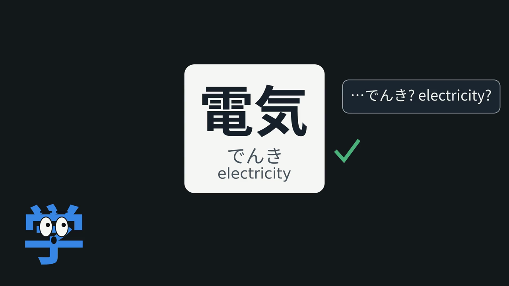
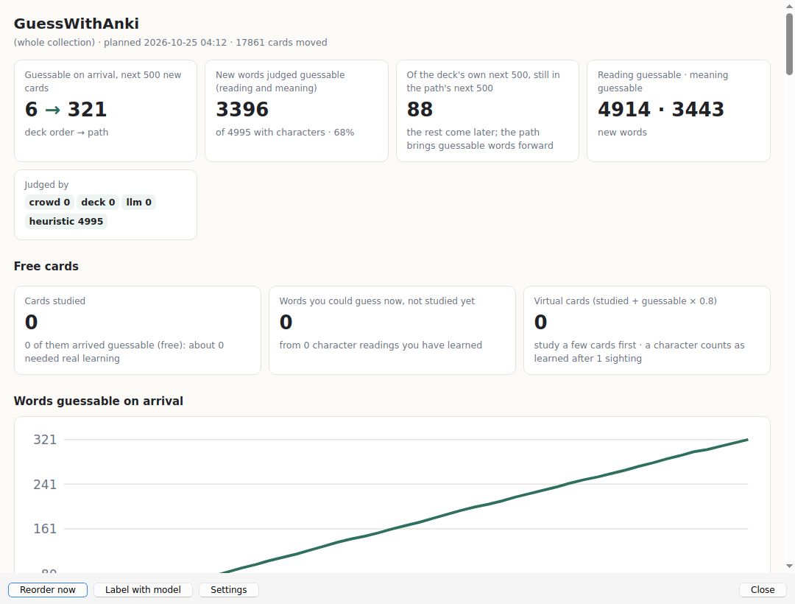
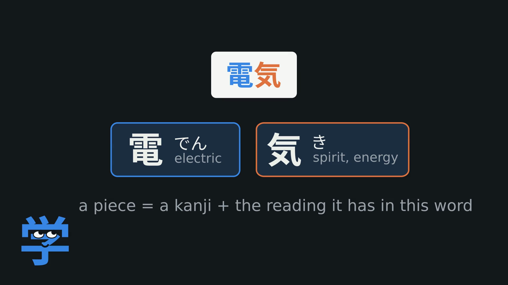
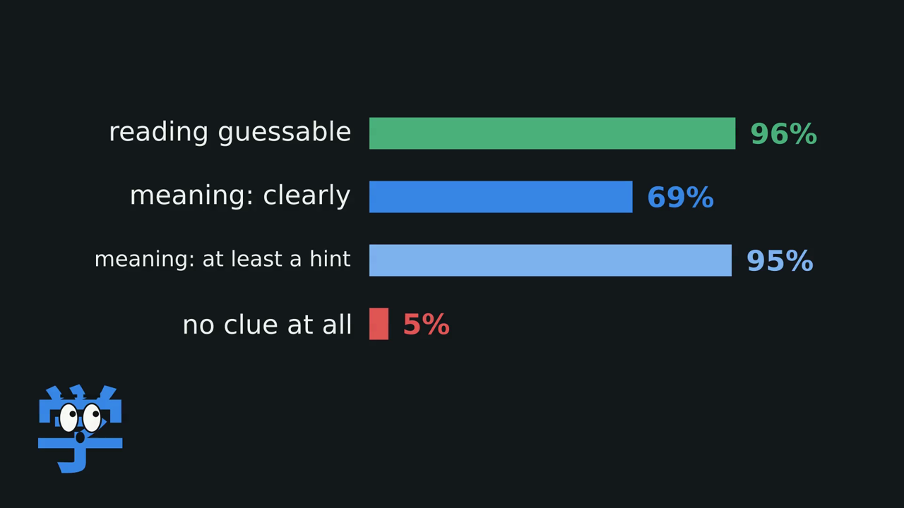
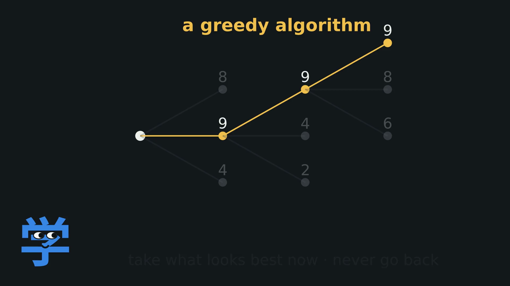
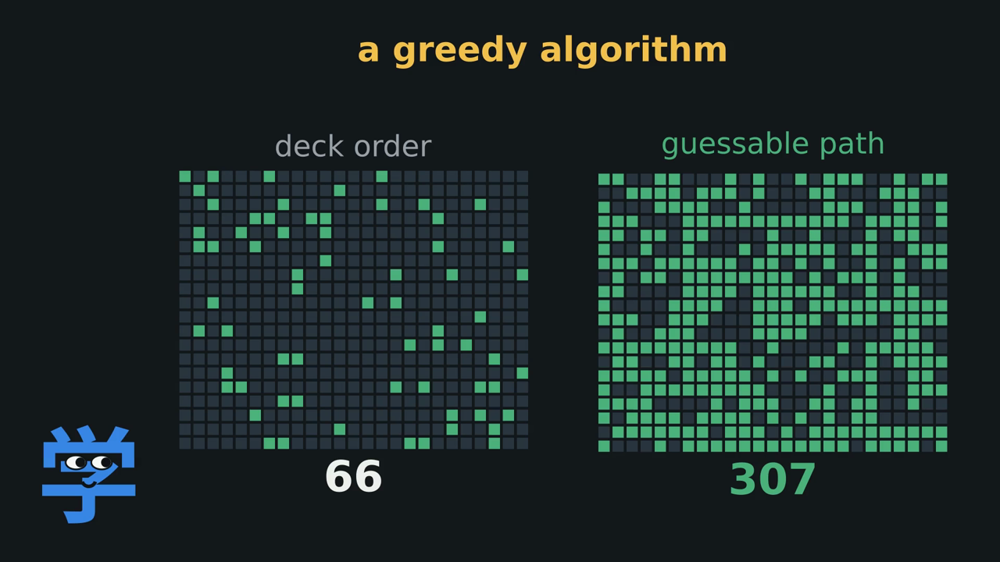
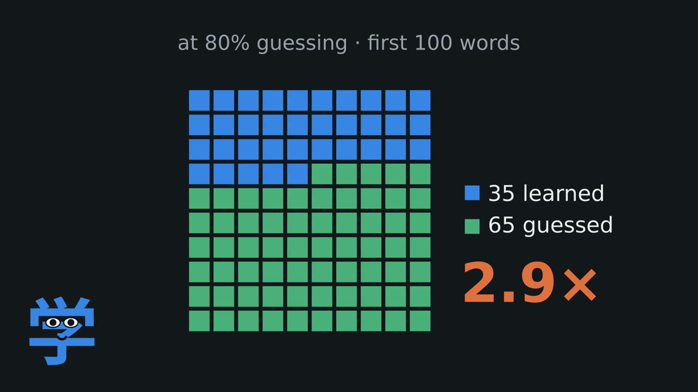
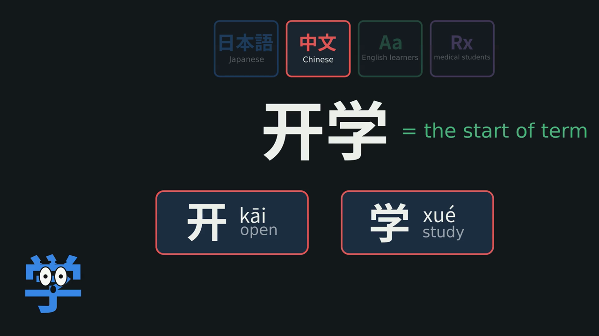
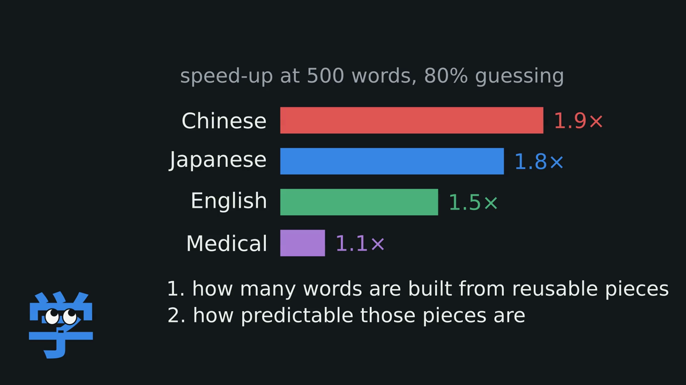

I'm still a beginner in Japanese, and I've always been amazed watching more advanced learners go through flashcards full of words they've never seen before and still guess the reading and meaning. To me, Japanese text basically looked like hieroglyphics.

Then, after a while of doing my own vocab cards, it started happening to me too. Every now and then I'd see a word for the first time, take a guess, flip the card, and be exactly right.

So I got curious and tried to actually measure how often that's possible, by breaking words into the pieces they're built from and checking whether those pieces give the word away. That led me down a rabbit hole of greedy algorithms and graph theory. The idea is that if you study the right building blocks first, a lot of new words become guessable without having to memorize them individually.

The result is [GuessWithAnki](https://github.com/BlaiseLabs/GuessWithAnki), an Anki add-on that reorders your deck so you can guess the meaning, and often the pronunciation, of a lot of cards on your first try.

## How it works

If you've already learned the pieces that make up a word, you can often figure out what it means without ever having studied the word itself. For example, suppose you've already studied

* 電車 (でんしゃ), train
* 天気 (てんき), weather

You've now encountered 電 pronounced as でん and 気 pronounced as き. GuessWithAnki recognizes this and moves 電気 (でんき) (electricity) forward in your deck, since you already know how to read its kanji in this word and have some clues about its meaning. Instead of memorizing 電気 entirely from scratch, you have a good chance of guessing it correctly the first time you see it.

A card you get right the first time you see it is what I call a free card, since you never had to learn it the hard way. GuessWithAnki looks for the words you're likely to figure out on your own, then puts them right after the cards that teach their pieces.

This builds on [GuessWithKanji](https://github.com/BlaiseLabs/GuessWithKanji), my first add-on, which only worked for Japanese. This time I wanted to see how far the idea goes beyond Japanese, so it now handles five kinds of decks.

| Deck | What counts as a piece | When a word is guessable |
|---|---|---|
| Japanese | A kanji paired with its reading in that word (電 read as でん) | Both the meaning and reading follow from its pieces |
| Chinese | A character paired with its pinyin syllable and tone (开 read as kāi) | Both the meaning and pinyin follow |
| Korean | A syllable with the Chinese character it comes from (학 from 學, study) | The meaning follows from its parts |
| English | A prefix, root, or suffix (un-, employ, -ed) | The meaning follows from its parts |
| Medical | A Greek or Latin root or affix (hepat, -itis) | The meaning follows from its parts |

The goal is to reward pattern recognition over memorizing.

GuessWithAnki encourages this by minimizing the amount of memorization needed to grasp an underlying pattern in a vocabulary deck.

This has the added effect of improving your memory, and giving you access to skills that are usually reserved for more advanced language learners.

## Demo

The video at the top walks through the different performance profiles of decks across languages. Below you'll see the potential gains in Chinese vocabulary decks, which are the best suited for this technique.

With GuessWithAnki you are able to learn the equivalent of 500 Chinese words with less than 200 words. Just by changing the order you study them in.

## How I Built It

### How guessable is a word?

I started by looking at how much overlap in kanji there was across words. The more unique kanji there were, the more difficult it would be to guess a word's meaning.

Luckily for me that's not how Japanese works, and as it turns out there was a large overlap between the words and the kanji they shared.

#### The reading

This part was surprisingly straightforward.

Two free dictionaries, KANJIDIC2 and JMdict, provide kanji readings and tens of thousands of vocabulary entries.

I wrote a small Python function to match each word's reading to its individual kanji. Compared against JmdictFurigana, it agreed on 99% of 17,854 common words.

Once you have those matches, you can count how frequently each reading occurs.

For example, 気 is read as き in 130 dictionary words, but as け in only 14.

So if you've learned 気 as き, a new word using that same reading becomes much easier to guess.

#### The meaning

Figuring out whether a word's meaning follows from its pieces is trickier.

I tried two approaches, both using open models.

- Embeddings. EmbeddingGemma represents each meaning as a point in a vector space. If a word's meaning is close to the meanings of its kanji, there's a good chance you can infer it. After tuning on labelled words, this approach achieved an AUC of 0.83, compared with 0.73 for simple word overlap.
- Asking a model directly. Gemma 4 runs locally through Ollama and labels words in batches. It judges whether the reading and meaning are predictable, partly predictable, or not predictable, using a JSON schema that specifies the exact words in each batch.

#### My own deck

I ran the analysis on my own deck of 2,038 words containing kanji.

Here's what I found.

For 67% of the words, both the reading and meaning were predictable.

In other words, roughly two out of every three words I was about to study were, at least in theory, words I could have guessed on first sight.

That was a much bigger share than I'd expected.

### 2. Finding the right order with a greedy algorithm

There's a catch, though. You can only guess a word if you've already encountered the pieces it's made of. For example, you can't guess 天気 (てんき) from its kanji if you've never learned 天 read as てん.

So this basically becomes a max/min problem. How do I maximize the number of guessable Anki cards while minimizing the amount of memorization needed?

Trying every possible order is out of the question. For 2,000 cards there are about 3.3 × 105735 possible orders.

This basically turns into something a lot like the traveling salesman problem, and one of the simplest ways to approach this is using a greedy algorithm. A greedy algorithm builds a solution one step at a time. At each step, it chooses whatever looks most promising right now, without going back to reconsider earlier decisions.

It doesn't guarantee the perfect solution, but it's fast, and can get pretty close.

At every step, the algorithm asks which card should come next.

- If a word is already guessable, it gets priority, especially if you've just encountered the pieces that make it up.
- If nothing is guessable yet, the algorithm looks for an *opener*, a card that introduces just one new piece, preferably one that will help unlock other words.

For example, you might study 取る (*toru*, to take), followed by 戻る (*modoru*, to return).

Once you've learned those pieces, 取り戻す (*torimodosu*, to take back) becomes guessable.

The algorithm tries to create as many of these little chains as possible.

On my own deck, this changed the number of guessable words among the next 500 cards from 66 to 307.

That's nearly five times as many words you might be able to figure out without first memorizing them.

### 3. Does it actually help?

Of course, a word being *theoretically* guessable doesn't mean you'll actually guess it correctly.

And even if you do, will it help you remember more over time?

To explore that, I built a simulation of someone studying with Anki for 100 days.

The simulated learner studies 20 new cards per day and completes every scheduled review. Reviews follow FSRS-6, Anki's scheduling algorithm, which I reimplemented and checked against py-fsrs.

Each piece of a word has its own memory state. That memory gradually fades, but gets reinforced whenever another word containing the same piece appears.

A word can only be guessed if the learner still remembers its pieces.

On a JLPT vocabulary deck, with perfect guessing, a learner would need to learn just 16 cards from scratch to know their first 100 words. The other 84 could be guessed.

100% guessing isn't realistic though. This isn't magic, and as learners we're still going to get some words wrong.

I checked my own Anki review history and found that when a word was guessable and I'd seen its kanji recently, I answered correctly about 73% of the time.

So I also tested a more realistic 80% guessing rate.

At that rate, reaching the first 100 words required learning just 35 cards from scratch, rather than 100.

And there was another benefit I hadn't expected. Less forgetting.

Every new word reinforces pieces you've already learned. So you're not just accumulating vocabulary. You're repeatedly practicing the patterns behind it.

In the Core 2k simulation, forgotten reviews by day 30 fell from 189 to 72.

The same ordering that made words easier to guess also helped keep their building blocks fresh in memory.

### 4. Does it work beyond Japanese?

Japanese turned out to be a great fit for this idea. But I wanted to know whether it would work for other subjects too.
Then I ran the same experiment on two decks each for Chinese learners, English learners, and medical students, and three decks for Korean learners.

The underlying algorithm stays the same. The only thing that changes is what counts as a reusable piece.

For speed, I used a cloud model to label the 21,624 words across these decks in parallel, processing about 2.6 million tokens. The add-on itself uses Gemma locally, processing one batch at a time.

Here are the results at an 80% guessing rate.

| Deck | Guessable | Cards to reach 500 words | Speed-up |
|---|---|---|---|
| New HSK 3.0, levels 1–4 (Chinese) | 71% | 392 → 200 | 2.0× |
| HSK 2012, levels 1–5 (Chinese) | 66% | 473 → 256 | 1.8× |
| Core 2k (Japanese) | 60% | 481 → 265 | 1.8× |
| Kaishi 1.5k (Japanese) | 64% | 474 → 282 | 1.7× |
| Oxford 3000 (English) | 27% | 494 → 303 | 1.6× |
| Korean Vocabulary by Evita (Korean) | 39% | 492 → 310 | 1.6× |
| 2k Essential Beginner Vocab (Korean) | 31% | 486 → 350 | 1.4× |
| 4000 Essential English Words | 20% | 494 → 356 | 1.4× |
| Medical Terminology with Etymology | 27% | 482 → 474 | 1.0× |
| TTMIK My First 500 Words (Korean) | 25% | 495 → 492 | 1.0× |

#### Chinese did even better than Japanese

Chinese turned out to be an even better fit than I'd expected.

A character usually has one reading, so the pinyin of about 96% of words can be predicted from their characters.

And 90% of HSK words share every character with at least one other word.

That gives the algorithm plenty of reusable pieces to work with.

The advantage also lasts. Even beyond a thousand words, the optimized order maintains a 1.6–1.8× lead.

#### Korean lands in the middle

Korean was a late addition, after someone asked for it.

Most Korean vocabulary is Sino-Korean, built from syllables that each come from a Chinese character (Hanja). So once you know 학생 (student) and 교실 (classroom), 학교 (school) gives itself away.

The catch is that native Korean words and loanwords don't split into pieces like that, so only about a third of a beginner deck is guessable.

Evita's deck still reached 1.6× at 500 words, and kept 1.5× past a thousand. The small TTMIK deck barely moved, since its pieces rarely come back.

#### English is more modest

Most everyday English words don't break neatly into meaningful pieces. Knowing the spelling of *beach*, for example, doesn't tell you what it means.

But word families offer a useful shortcut.

Once you know *employ*, words like *employer*, *employment*, and *unemployed* become much easier to figure out.

The gains aren't as dramatic as in Chinese or Japanese, but they're still meaningful.

#### Medicine was the surprise

I initially thought medical terminology would be the perfect use case.

So many medical terms are built from Greek and Latin roots. So I figured they would especially benefit from greedy based sorting.

But the medical terminology deck barely improved on its own.

The problem was the deck itself. It was relatively small and mixed together technical terms, abbreviations, drug names, and everyday vocabulary. Many roots simply didn't appear often enough to be reused.

Medical students are often advised to learn the roots first. But with a roots deck placed ahead of the terminology deck, the learner has to get through 982 root cards before seeing the first medical term, around day 50.

GuessWithAnki takes a different approach.

Instead of teaching every root up front, it introduces only the roots needed for the next terms, right before those terms appear.

That means the learner can start guessing actual medical terminology within the first two weeks.

So even when the raw speed-up looks small, changing the order can make the learning experience very different.

Across all five profiles, the pattern became clear. What matters is how often meaningful pieces get reused, and how reliably they predict the words built from them.

## The Lazy Payoff

With an 80% guessing rate, the simulation suggests you could reach your first 500 Chinese words while learning only about half as many cards from scratch. Japanese comes close.

You get more words from less memorization, reinforce the pieces you already know, and spend more of your time recognizing patterns instead of treating every word as something completely new.

And that's what brings me back to those advanced Japanese learners who seemed to know words they'd never studied.

Now I understand they were able to do this by learning enough pieces to start seeing the patterns in kanji across words.

GuessWithAnki is my attempt to help the rest of us get there sooner.
